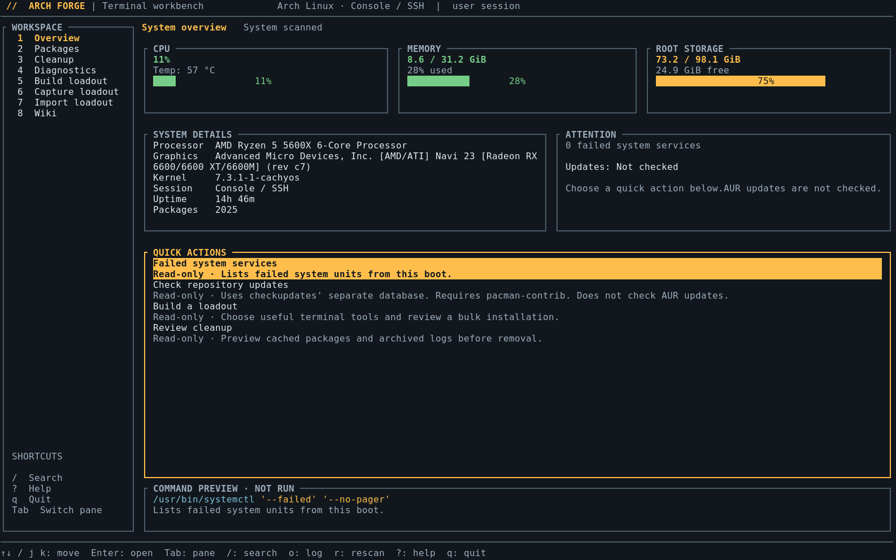

<p align="center">
  
</p>

# Arch Forge — Arch Linux desktop and terminal tools

Arch Forge is a native **Arch Linux system utility** built with Rust. Use the **GTK4 desktop app** (`archforge`) or the **keyboard-driven terminal interface** (`archforge-cli`) to manage packages, review cleanup, inspect your system, and save reusable package loadouts. The terminal edition works in a Linux console or SSH session without a graphical desktop.

Use Loadouts to select apps in bulk and save a package selection for a fresh Arch install. The desktop edition also includes gaming tools and Ricing: community desktop setups with real screenshot galleries, formatted READMEs, and reviewed installation instructions. Neither edition requires Hyprland.

[Download the latest release](https://github.com/Zynokss/archforge/releases/latest) · [Installation](#install-arch-forge-on-arch-linux) · [Features](#features) · [Terminal edition](#terminal-edition) · [Changelog](CHANGELOG.md) · [Report a bug](https://github.com/Zynokss/archforge/issues)

Run either edition as your regular user. Actions that need administrator access show a review and request authentication separately.

## Features

- **Terminal workbench** — full-screen keyboard navigation, categories and bulk selection, background inspections, syntax-colored command previews, and searchable/exportable logs.

- **Overview** — live CPU, memory, and storage readings, hardware details, uptime, temperature, failed-service findings, and quick actions.
- **Tools** — searchable Arch Linux utilities for storage, services, boot performance, networking, and package checks.
- **Loadouts** — browse apps by category, select packages in bulk, and export a reusable package selection.
- **Ricing** — discover Hyprland desktop setups, browse dotfiles and screenshot galleries, and review upstream installation instructions.
- **Gaming** — installation checks and setup guidance for Steam, GameMode, MangoHud, Vulkan tools, Gamescope, and Lutris.
- **Cleanup** — package-cache usage and previews, journal usage, orphan-package inspection, and reviewed cleanup actions.
- **Packages** — browse installed packages and the curated catalog, search descriptions, filter sources and categories, sort and paginate results, and review bulk package actions. Categories include known package variants; packages outside the catalog appear under Uncategorized. Reset filters clears the search, source and category selections. Installed size and foreign-package counts come from the local database; the Updates tab reflects existing sync databases, with a separate fresh update check.
- **Diagnostics** — failed services, boot timing, Vulkan information, and a system report with copyable output.
- **Wiki** — offline command reference with search, official documentation links, and saved entries in the desktop app.
- **Settings** — startup and appearance preferences, update controls, and project information in the desktop app.
- **App updates** — desktop version checks and one-click installation of verified GitHub release packages.

## Screenshots

**Desktop app** — live system overview, maintenance findings and recovery tools.


**Terminal interface** — the same workbench from a console or SSH session, without a graphical desktop.



## Install Arch Forge on Arch Linux

On **Arch Linux x86_64**, install the latest prebuilt release with:

```sh
curl -fLO https://github.com/Zynokss/archforge/releases/latest/download/archforge-x86_64.pkg.tar.zst
sudo pacman -U ./archforge-x86_64.pkg.tar.zst
```

This installs both `archforge` and `archforge-cli` system-wide, including the desktop app’s **application-menu shortcut and red icon**. Open your application launcher, search for **Arch Forge**, and launch it. You only need the terminal for installation; Rust and a source checkout are not required.

You can also download the `.pkg.tar.zst` from the [latest release](https://github.com/Zynokss/archforge/releases/latest) and install the downloaded file with `sudo pacman -U /path/to/package.pkg.tar.zst`. If your desktop has an Arch package installer, you can open the package with that instead.

The desktop edition requires GTK4 4.20 or newer, VTE, and a desktop polkit authentication agent for app-update installation. Both editions use sudo for reviewed terminal commands. Run the app as your regular user. It refuses to run as root or on a distribution whose `/etc/os-release` does not identify it as Arch Linux.

### Terminal-only installation

On Arch Linux x86_64 without a graphical desktop:

```sh
curl -fLO https://github.com/Zynokss/archforge/releases/latest/download/archforge-cli-x86_64.pkg.tar.zst
sudo pacman -U ./archforge-cli-x86_64.pkg.tar.zst
archforge-cli
```

The standalone package has no GTK or VTE dependency. Choose either the full package or the terminal-only package; the full package already includes the TUI, and pacman will ask to replace conflicting editions if you switch. Update the standalone edition by downloading and installing its newer release package. Remove it with `sudo pacman -Rns archforge-cli`.

### Install from source

For aarch64, or if you prefer to build locally:

```sh
sudo pacman -Syu --needed base-devel rust git
git clone https://github.com/Zynokss/archforge.git
cd archforge
./scripts/install.sh
```

If you already cloned the repository, run `git pull --ff-only` followed by `./scripts/install.sh` inside it. The installer builds an Arch package and uses pacman to install the app, its runtime dependencies, launcher, and icons. Run it as your regular user; pacman will ask for administrator authentication when needed.

### Updates

Arch Forge checks for stable releases in the background when it opens. Choose **App updates** in the sidebar to see the running app version, release notes, and a manual check. When a newer version is available, the sidebar shows **Update available**.

Click **Update to …** to download and install it. The app checks the package's SHA-256 digest against GitHub's release metadata and verifies its name, version, and architecture before starting pacman. Your desktop asks for administrator authentication. Pacman handles dependencies and file ownership; an unsuccessful download or checksum check never starts installation. Arch Forge restarts automatically after installation, waiting for any running in-app cleanup or maintenance operation to finish. A failed restart offers a retry button.

Updates require an internet connection, `curl`, and a desktop polkit agent. Downloaded packages come from this project's GitHub releases and are not separately signed. Automatic installation is available only when a package for your architecture is attached to the release; aarch64 users can build from source. Checking does not install anything until you click Update.

### Package availability

Arch Forge is distributed through GitHub Releases. It is not currently published in the AUR or Arch's official repositories, so `pacman -S archforge` and AUR-helper installation are not available. The package installed above is tracked by pacman and can be removed with `sudo pacman -Rns archforge`.

If you installed an older `arch-forge` package, run the installation command above once and accept pacman's replacement prompt. The package and executable are now named `archforge`; the application-menu name remains Arch Forge.

### Development

To run a checkout without installing it, install the build dependencies and use:

```sh
sudo pacman -Syu --needed rust gtk4 vte4 sudo pkgconf pciutils polkit curl
cargo run --release --locked
```

`cargo run` only builds and opens the app. It does not install an application-menu entry, icon, or system binary. Use one of the installation methods above for normal desktop use.

### Optional tools

| Package | Used for |
| --- | --- |
| `pacman-contrib` | Update checks and package-cache maintenance |
| `vulkan-tools` | Vulkan diagnostics |
| `gamemode` | GameMode integration and self-check |
| `mangohud` | In-game performance overlay |
| `ttf-material-symbols-variable` | Rounded interface icons |

A desktop polkit authentication agent is required for the desktop updater. Reviewed command sessions use sudo. Google Sans Flex is used when available; the interface falls back to Rubik or the system sans-serif font. Native symbolic icons are used when the Material font is absent.

## Maintenance

Cleanup always starts with a review. Package-cache cleanup keeps the latest two cached versions; a separate action removes all archives for uninstalled packages. Journal cleanup removes archived files older than seven days. Each system cleanup first loads a read-only preview before enabling authentication. Orphan dependencies can be inspected, then removed through a reviewed interactive pacman transaction in a terminal. Empty lists never start a removal command.

Protected pacman download folders can prevent a complete unprivileged size check. Arch Forge marks that result as partial and offers an authenticated, read-only measurement.

Package setup and reviewed commands open an embedded GTK terminal inside Arch Forge. Each session explains the action and shows an editable Bash command. Editing clears the review checkbox. **Authenticate & run** stays disabled until the command has been reviewed. Every run ignores sudo's credential cache and requests fresh authentication before executing; passwordless sudo validation is blocked rather than treated as a confirmed password entry. PAM/sudo policy still controls the authentication mechanism. Commands run as the desktop account and invoke sudo only where the command specifies it. Password input is handled by the terminal and sudo, without being copied into application logs. The session clears its sudo credentials on exit and refuses to close while a child process is still running. Use Ctrl+C to cancel, then wait for the process to exit. Completed output remains visible; another run requires review and fresh authentication again.

The terminal uses VTE with a black background, a colored ANSI palette and normal interactive prompts. It runs commands in Bash, with the desktop account's environment; it does not embed a separate terminal application's UI or custom shell configuration. The package depends on `vte4` and `sudo`. Steam launch options remain copy-only for Steam. Package changes refresh the package list after transactions finish.

Personal cleanup offers home Trash, yay build cache, pip cache, and thumbnails. Paths come from the current account and `XDG_DATA_HOME` / `XDG_CACHE_HOME`, with standard home-directory defaults; pip also honors `PIP_CACHE_DIR`. Relative XDG paths are ignored. No username is embedded in the application. Trash cleanup covers the home Trash's files and metadata, not Trash directories on other mounted volumes.

Personal cleanup previews selected entries and requires a separate permanent-clean action. It runs as your regular user, includes hidden entries, keeps the cache root folders, and refuses root/home directories or linked cleanup roots. Deletion uses retained directory descriptors, does not follow symlinks, and does not traverse other filesystems. Changed root folders require another review. Close apps using a cache first; active apps can recreate cache files. A separate `yay -Sc --aur` action opens a terminal and lets yay ask which AUR cache entries to remove, without running yay as root or hiding errors.

Command dialogs keep the full output visible beside a summary of the result. The output scrolls independently, with colors for warnings, errors, and completion messages; action buttons stay visible. Summaries show reported values such as cache size, cleanup candidates, failed units, startup duration, and Vulkan device information. The Diagnostics page also shows key findings beside the log, including affected services, the slowest startup unit, GPU and driver details, and report usage figures. Missing fields stay marked as not reported. Empty package-cache previews show zero candidates and disable cleanup; commands and complete output remain available to inspect and copy.

### Additional cleanup tools

Cleanup also groups optional maintenance tasks into **Storage review**, **Apps & containers**, and **Logs, temp & snapshots**:

- Rank large installed packages, inspect home-cache usage, find home files over 1 GiB, and list pacman configuration leftovers without deleting them.
- Inspect Docker disk use and remove dangling images through Docker's interactive prompt; volumes and containers are kept.
- Review unused Flatpak refs separately for user and system installations. App data and named custom installations are kept.
- Inventory VirtualBox machines and disks without removing them.
- Preview and apply systemd's configured age-based temporary-file cleanup, or use a 50 MiB archived-journal budget instead of the default seven-day cleanup.
- List Timeshift snapshots or create an on-demand snapshot with an existing configured Timeshift installation.

Optional tools are enabled only when their executable is installed. Docker also needs daemon access; Timeshift needs configuration and administrative authentication. Inspections can report permission errors or partial results. Applying system cleanup opens a reviewed terminal command; nothing runs automatically when the page opens.

These additions were informed by [4lgn's Arch Linux cleanup notes](https://gist.github.com/4lgn/4a31df668321cf95a790fdb29615a846) and [arch-cleaner](https://github.com/antonio-foti/arch-cleaner), with separate inspections and interactive actions in Arch Forge.

## Terminal edition

Run **`archforge-cli`** for a full-screen Rust TUI built with Ratatui and Crossterm. The full desktop package includes it; `archforge --tui` opens the same interface. An interactive console without display variables selects terminal mode automatically when launching `archforge`. The standalone package needs no GTK, VTE, compositor, display server, mouse, or Nerd Fonts.

```sh
# Install only the terminal edition:
./scripts/install.sh --cli

# Run from source without graphical dependencies:
cargo run --release --locked --no-default-features --bin archforge-cli

# Non-interactive reports (also selected automatically for redirected input/output):
archforge-cli --plain overview
archforge-cli --plain packages
archforge-cli --plain diagnostics
archforge-cli --plain wiki
```

The persistent workspace contains Overview, Packages, Cleanup, Diagnostics, Build loadout, Capture loadout, Import loadout and Wiki. Overview reads actual CPU, memory, storage and hardware data. Unavailable readings and unchecked updates are labeled explicitly. Read-only scans run in background workers; selections and list positions survive navigation. Smaller terminals hide secondary panels, accessible with Tab. `NO_COLOR` removes interface colors while retaining reverse-video focus.

- **Arrow keys / j / k** navigate; **Enter** opens; **Tab / Shift+Tab** switches panes; **Esc** returns; **1–8** changes workspace; **?** opens help; **q** quits.
- **Space** selects packages; **a** selects/clears matching entries; **f** filters status; **t** filters repository/foreign/AUR-recipe sources; **S** cycles installed-first/A–Z/Z–A sorting; **R** resets search/category/status/source filters while retaining selection; **/** searches; **+** adds exact names. **i** reviews installation, **d** reviews removal, **s** exports the selection, **x** clears it. Bulk selections are limited to 5,000 entries.
- **u** reviews a repository update check, **U** reviews a full system upgrade, **r** rescans. Update checks use checkupdates' separate database and do not cover AUR recipes.
- **o** opens the retained output viewer. **/** filters output, **PageUp/PageDown** scrolls, **Left/Right** pans long lines, **c** requests terminal clipboard copy using OSC 52, and **e** exports to a new private file. Linux consoles and emulators that block OSC 52 can use export instead.

Selecting an operation only previews its command. Opening it shows a review panel; the **I reviewed the command** checkbox sits beside a separate execution control. **Up/Down** scrolls long review details, and **Tab** moves between checkbox and execution. Read-only inspections run in the background after review. Privileged operations restore the normal terminal and use a real PTY for sudo, package prompts and command input. Authentication and execution share that PTY. Fresh authentication is required each time; passwordless validation is rejected. Only terminal output is recorded, never the input stream. Passwords remain sudo's responsibility. On completion, the TUI returns with the output retained and sudo credentials invalidated. Ctrl+C cancels the child session; exit, errors and termination signals restore terminal modes and cursor visibility.

Terminal loadouts share the desktop catalog, shared installed-package variant matching, offline Wiki data and JSON profile format. The Build loadout library includes selected terminal-capable tools. Installation uses configured repositories, skips installed packages and performs a full system upgrade. AUR entries are reference-only; the terminal edition does not build unreviewed recipes. Imports exclude AUR/foreign packages and dotfiles, and only prepare a selection for review. Captures save explicitly installed package names without personal files, passwords or repository URLs. Exports refuse to overwrite existing files. Ricing and appearance controls stay in the desktop edition.

Package categories and details inherit catalog metadata for installed variants and exact-name additions. The focused row shows the actual installed package/version and description when space permits. Source filters use that installed identity; foreign/local packages remain separate from AUR recipes. Selection exports deduplicate actual installed names and preserve repository versus foreign source classification. Rescans retain category identity and invalidate cached update flags for changed package versions.

The standalone `archforge-cli` package and full `archforge` package are alternatives: the full package includes the terminal executable. `util-linux` supplies the PTY session recorder. `--plain` without a report name retains the older numbered interface when used interactively; non-interactive use always produces a read-only report and never authenticates or changes packages.

## Wiki field guide

The **Wiki** tab below Ricing provides an offline field guide with 76 command cards across 11 topics: getting started, packages, files and permissions, services, networking, storage, hardware, Hyprland/Wayland, shell usage, troubleshooting, and backups. Browse by topic, search all cards, use the command cheat sheet, or save entries for later. Bookmarks are stored locally under `$XDG_CONFIG_HOME/archforge/wiki-saved.json` (normally `~/.config/archforge/wiki-saved.json`).

Each card explains its effect and links to official documentation. Read-only commands can be inspected in the shared output viewer. Concrete system-changing commands open the embedded review dialog; examples containing UPPERCASE placeholders remain copy-only until adapted. The guide does not run commands when browsed and does not duplicate the full ArchWiki. Its offline summaries are a starting point; consult the linked current documentation for hardware-specific procedures and unfamiliar changes.

The embedded review footer has a prominent **I reviewed the command** checkbox, clear disabled-run guidance, and separate command and terminal-output panels. Editing a command clears its review; the existing fresh-authentication gate is preserved.

## Command output viewer

Diagnostics, cleanup previews and tool results use a shared read-only output viewer. Search within the log and jump between matches, toggle line wrapping, inspect line numbers, copy the original output, or save it as a text file. **Expand** opens the same output buffer in a larger window without re-running the command. The summary above the log shows the action status and available key facts. Read-only diagnostic jobs also offer **Run again** after the current check finishes. Cleanup and installation actions retain their separate review and authentication steps.

## Overview and Settings

Overview presents live CPU, memory and storage readings, GPU identification, system details, failed-service inspection, package update checks, and quick links to the main workspaces. **Capture this system** opens Loadouts' existing capture review; it does not save or apply files automatically. The refresh button reloads hardware and service information.

**Settings**, below App updates and Appearance, provides access to both controls, a startup update-check preference, reduced-motion preference, version information, and links to Zynokss, the source repository, issue tracker and license notices. Preferences are stored locally in `~/.config/archforge/preferences.json`, respecting an absolute `XDG_CONFIG_HOME`. Manual update checks remain available when automatic startup checks are disabled.

## Appearance

Choose Crimson, Amber Night, Arch Night, Sage, Lavender, Sand, or Desktop colors from the sidebar. Every palette uses deep tinted surfaces, illuminated outlines, accent-colored hover glow and a matching Arch banner across the main pages. Crimson uses black-red surfaces and vivid red lighting; Arch Night keeps the midnight-blue and cyan treatment. Banners simplify in compact windows to keep headings and controls readable. The selection is saved in `~/.config/archforge/appearance`, respecting `XDG_CONFIG_HOME`.

Desktop colors can follow an existing end4/Quickshell palette at `~/.local/state/quickshell/user/generated/colors.json`, respecting `XDG_STATE_HOME`. If that palette is unavailable, the app uses Sage. Arch Forge does not modify the shell configuration.


## Arch Linux tools and navigation

Use **Tools** to search by task (for example, `missing files`, `boot`, `DNS`, or `cache`), or use the category tabs. The grouped view starts with short previews for each category; **View all** opens the complete category. Search returns all matching tools, with no preview limit. Sort by recommended order or name, or switch to a compact list. Every tool has a built-in outline icon, independent of the desktop icon theme. **Ctrl+K** opens tool search; **Ctrl+1–9** switch between Overview, Tools, Gaming, Cleanup, Packages, Diagnostics, Loadouts, Ricing, and Wiki. Read-only tools include package file checks, package-list export, file ownership, package history, drives, mounts, free space, enabled services, timers, boot errors, boot timing, SSD trim status, network addresses, DNS status, and power profiles. Output can be copied or saved; system changes open an editable command in the embedded terminal and wait for review and authentication.

**Package cache location** changes where pacman downloads package archives. Installed files keep the locations defined by their packages; pacman's `RootDir` is intended for another installation or chroot. Arch Forge inserts a managed first `CacheDir` in `[options]`, preserves existing entries as fallbacks, validates the proposed configuration with `pacman-conf`, and backs up `/etc/pacman.conf` before an atomic replacement. Existing archives are kept. The cache measurement and paccache tools follow the configured cache directories.

The cache folder must use a mounted Linux filesystem and protected, root-owned parent directories; symlinks, group/other-writable paths, and sensitive system trees are refused. The parent must exist; the final cache folder can be created with mode 0755. Removable drives must be mounted before use. **Restore previous settings** removes only Arch Forge's managed entry, preserves other edits, and creates another backup. Applying either action requires the installed current version of Arch Forge and an explicit `sudo` command in the embedded terminal. No configuration changes happen merely by opening the setting.

References: [pacman configuration](https://man.archlinux.org/man/pacman.conf.5.en), [pacman-conf](https://man.archlinux.org/man/pacman-conf.8.en), [paccache](https://man.archlinux.org/man/paccache.8.en).


## Installing apps on another drive

Open **Tools → Storage → App install locations**. Flatpak mode can register a mounted Linux data filesystem, then install an application by its Flatpak ID into that named location. Refresh after completing the setup command. The command adds Flathub to the selected installation and retains Flatpak's interactive transaction review. Existing apps are not moved. App data stays in the home directory, and temporary downloads or metadata can still need system space. Sign out and back in if shortcuts from a newly added installation are missing.

This setup accepts persistent, root-owned mounts under `/mnt`, `/media`, or `/home` using ext4, Btrfs, XFS, or F2FS with execution enabled. The root filesystem and filesystems sharing its backing device are excluded. The administrator-reviewed helper creates a dedicated folder and a new configuration file without replacing existing installations. Its filesystem UUID and mount point are recorded; installation commands check both before invoking Flatpak. Drives must stay mounted to run their apps. The current installed Arch Forge version is required for these helper commands.

**Pacman: system package storage** shows where `/usr` is mounted and how much root space remains. Pacman packages use the paths specified by their packages. Growing that storage requires expanding or migrating a filesystem, or a layout-specific mount plan; this feature does not move system directories, edit `fstab`, or provide per-package drive selection. Cache relocation is a separate setting for downloaded archives.

Reference: [Flatpak custom installations](https://docs.flatpak.org/en/latest/tips-and-tricks.html#adding-a-custom-installation).


## Loadouts: prepare apps for a fresh Arch Linux install

Open **Loadouts** to choose from 659 curated packages across 17 categories, including desktop apps, terminal tools, office and study, graphics and CAD, backup, networking, virtualization, accessibility, and AI/ML. The catalog includes 621 official repository packages and 38 selected AUR recipes. Search spans package names and descriptions. Source and status filters, pagination, **Select matches**, and exact-name additions keep larger selections manageable. Category navigation scrolls independently; compact windows use a category dropdown. **Recommended** places curated common choices before more options and specialist tools, using an October 2026 pkgstats snapshot within each group. **Popular first** uses those survey percentages directly; alphabetical and installed-first sorting are also available. See [catalog sources and selection rules](data/loadouts/CATALOG.md) for the scope and limits of these rankings. Selections stay in place while package database updates refresh the other pages.

Loadouts uses a checkbox-first package table with highlighted selections. **Build loadout** shows the library; **Manage installed** filters it to installed entries. The selection panel separates packages to install from packages already installed, with per-item removal from the selection. Removing a selection item does not uninstall it. Larger selections scroll within the summary so review/install and script export remain accessible. Uninstall and system-update controls are grouped under **Installed package actions**.

- **Capture this system** reads explicitly installed repository and foreign package names, plus enabled repository names for reference (without saving URLs or keys). Configuration folders are optional and unchecked by default. Preview the snapshot, then save its JSON file to another drive or your own backup storage.
- **Save selection** exports the packages and checked dotfiles currently in the workspace. **Import profile** loads a saved selection without installing or applying anything.
- **Package status** distinguishes installed versions, cached archives, missing packages, and repository updates. Status filters help narrow the list. **Skip installed packages** is enabled by default; saved profiles and exported scripts still retain the full selection for another installation. Cached archives may be older; pacman verifies and reuses suitable files.
- **Check for updates** uses `checkupdates` from pacman-contrib, which refreshes a separate database. It does not check AUR packages. **Update system** reviews a full repository upgrade rather than a partial package upgrade.
- **Uninstall** on a package, or **Uninstall selected**, first runs a read-only dependency preview. If another app needs a selected package, the dialog lists the blockers without opening a terminal. Otherwise it opens a reviewed `pacman -R` command. Pacman checks dependencies and asks for confirmation; recursive dependency removal and automatic acceptance are not enabled. Installed/cache status refreshes periodically while the package list is visible.
- **Install missing** opens a reviewed command in the embedded terminal. Repository packages use `pacman -Syu --needed`; AUR packages use an already installed `paru` or `yay` as your regular user. **Export install script** creates a standalone package-only script. Neither flow silently accepts transactions or bootstraps an AUR helper.
- **Package variants** share matching across Packages, Loadouts, Gaming and the terminal edition. Terminal `-bin`, `-git`, `-svn`, `-hg`, `-bzr`, `-cvs` and `-darcs` suffixes inherit catalog categories and icons. Exact installed names take priority; ambiguous alternatives require an exact choice. Installed status and skip-installed checks use the same matching, while inspection, removal and captures retain real package names. Yay/paru installations are read through pacman's database. Debug packages, plugins and differently named forks stay separate, and a suffix never assigns an AUR source by itself.
- Foreign packages can be local builds, so they are not silently treated as AUR packages. The optional foreign-to-AUR checkbox is an explicit source decision. Custom repositories and multilib must already be configured where needed.

Desktop kits cover Hyprland, KDE Plasma, GNOME, Xfce, Cinnamon, and Sway. Two starter color bundles, **Amber Night** and **Crimson Night**, include Kitty and GTK settings; Hyprland and Sway also get compositor and Waybar starters; Plasma gets a KDE color scheme and matching color settings. Hyprland's starter uses the current Lua configuration format. GNOME, Xfce, and Cinnamon kits install session packages and shared app colors, leaving desktop-wide appearance to their own settings. No display manager or service is enabled automatically.

**Review dotfiles** compares checked text files with their current contents. Apply is a separate action: replaced files are backed up under `$XDG_STATE_HOME/archforge/loadouts/backups` (normally `~/.local/state/archforge/loadouts/backups`) before per-file atomic writes. Backups and exported profiles are private files. Symlinked paths, paths outside the allowed configuration roots, oversized bundles, and files changed since preview are refused. Home-directory references captured in text are represented by a portable placeholder and resolved for the destination account.

The backup restores replaced files; newly created files are listed in its metadata for manual removal when undoing a profile. If a later write fails, the output identifies the partial result and backup. Configurations can contain startup commands and private values: review imported files before applying or sharing them. Writing desktop configs may trigger the desktop's own file watchers; Arch Forge does not send reload, focus, or workspace-switch commands.

A loadout is not a disk image. Partitions, accounts, boot setup, repository configuration, services, drivers that need hardware-specific setup, and personal documents require their own backup or setup plan. Keep your exported loadout outside the installation you may lose.

The image-inspired **Amber Night** app palette is available under **Appearance**. It uses amber accents with cool charcoal surfaces; selecting it does not change your desktop's configuration.

## Application artwork

Loadouts ships with selected [Papirus](https://github.com/PapirusDevelopmentTeam/papirus-icon-theme) and [Simple Icons](https://github.com/simple-icons/simple-icons) artwork, so app logos are available even before the apps are installed. A shared offline resolver uses a recognizable app logo first, then a package function symbol, a category symbol, and finally a generic package outline. Functional symbols are bundled local SVGs; no icon theme or runtime download is required. Source code and functional symbols are MIT licensed; application artwork licenses and attribution are listed in [the icon notices](data/app-icons/NOTICE.md).

## Hyprland dotfiles and desktop ricing

Browse curated community desktop setups in the Ricing sidebar tab. Discover real repository screenshots, open a setup for its gallery and formatted README, and review documented installation methods before opening a terminal. Downloaded previews are cached locally. Installation instructions include upstream links and compatibility notes; opening a setup never runs its installer.

## License

[MIT](LICENSE). Bundled application artwork has separate licenses listed in [the icon notices](data/app-icons/NOTICE.md). Arch Forge is an independent project and is not affiliated with Arch Linux.
