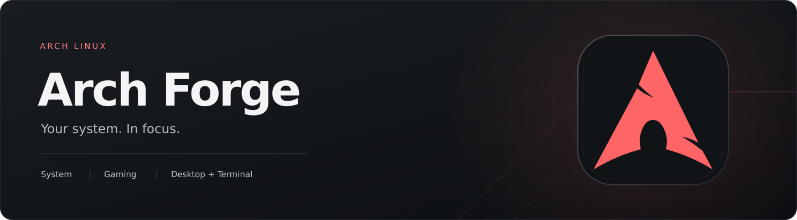
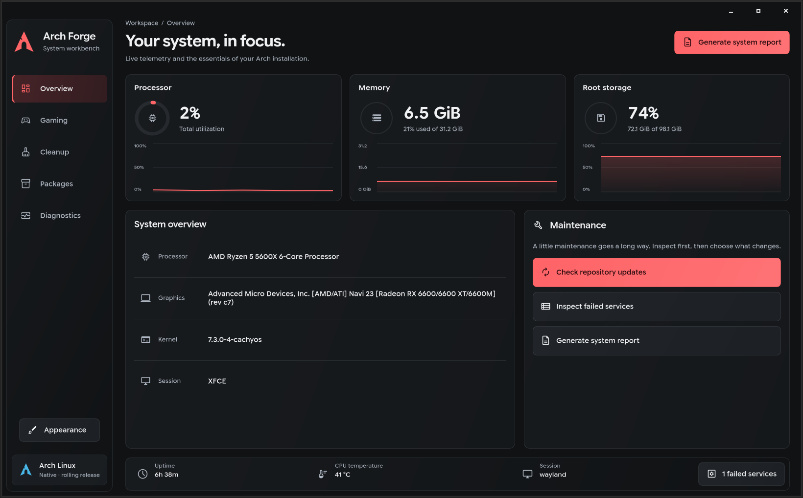

<p align="center">
  
</p>

A native desktop utility for Arch Linux, built with Rust and GTK4.

Arch Forge brings system readings, gaming tools, package information, and maintenance commands into one place. Commands run as your desktop user; actions that need administrator access ask for authentication separately.

## Features

- **Overview** — live CPU, memory, and storage graphs, hardware details, uptime, temperature, and failed-service status.
- **Gaming** — installation checks and setup guidance for Steam, GameMode, MangoHud, Vulkan tools, Gamescope, and Lutris.
- **Cleanup** — package-cache usage and previews, journal usage, orphan-package inspection, and reviewed cleanup actions.
- **Packages** — search and sort installed packages, inspect foreign packages, and check repository updates.
- **Diagnostics** — failed services, boot timing, Vulkan information, and a system report with copyable output.
- **App updates** — automatic version checks and one-click installation of verified GitHub release packages.

## Screenshots



## Install

On **Arch Linux x86_64**, install the latest prebuilt release with:

```sh
curl -fLO https://github.com/Zynokss/archforge/releases/latest/download/archforge-x86_64.pkg.tar.zst
sudo pacman -U ./archforge-x86_64.pkg.tar.zst
```

This installs Arch Forge system-wide, including its **application-menu shortcut and red icon**. Open your application launcher, search for **Arch Forge**, and launch it. You only need the terminal for installation; Rust and a source checkout are not required.

You can also download the `.pkg.tar.zst` from the [latest release](https://github.com/Zynokss/archforge/releases/latest) and install the downloaded file with `sudo pacman -U /path/to/package.pkg.tar.zst`. If your desktop has an Arch package installer, you can open the package with that instead.

Arch Forge requires GTK4 4.20 or newer and a desktop polkit authentication agent for administrator actions. Run the app as your regular desktop user. It refuses to run as root or on a distribution whose `/etc/os-release` does not identify it as Arch Linux.

### Install from source

For aarch64, or if you prefer to build locally:

```sh
sudo pacman -Syu --needed base-devel rust git
git clone https://github.com/Zynokss/archforge.git
cd archforge
./scripts/install.sh
```

If you already cloned the repository, run `git pull --ff-only` followed by `./scripts/install.sh` inside it. The installer builds an Arch package and uses pacman to install the app, its runtime dependencies, launcher, and icons. Run it as your regular user; pacman will ask for administrator authentication when needed.

### Updates

Arch Forge checks for stable releases in the background when it opens. Choose **App updates** in the sidebar to see the running app version, release notes, and a manual check. When a newer version is available, the sidebar shows **Update available**.

Click **Update to …** to download and install it. The app checks the package's SHA-256 digest against GitHub's release metadata and verifies its name, version, and architecture before starting pacman. Your desktop asks for administrator authentication. Pacman handles dependencies and file ownership; an unsuccessful download or checksum check never starts installation. Reopen Arch Forge after the update completes.

Updates require an internet connection, `curl`, and a desktop polkit agent. Downloaded packages come from this project's GitHub releases and are not separately signed. Automatic installation is available only when a package for your architecture is attached to the release; aarch64 users can build from source. Checking does not install anything until you click Update.

### Package availability

Arch Forge is distributed through GitHub Releases. It is not currently published in the AUR or Arch's official repositories, so `pacman -S archforge` and AUR-helper installation are not available. The package installed above is tracked by pacman and can be removed with `sudo pacman -Rns archforge`.

If you installed an older `arch-forge` package, run the installation command above once and accept pacman's replacement prompt. The package and executable are now named `archforge`; the application-menu name remains Arch Forge.

### Development

To run a checkout without installing it, install the build dependencies and use:

```sh
sudo pacman -Syu --needed rust gtk4 pkgconf pciutils polkit curl
cargo run --release --locked
```

`cargo run` only builds and opens the app. It does not install an application-menu entry, icon, or system binary. Use one of the installation methods above for normal desktop use.

### Optional tools

| Package | Used for |
| --- | --- |
| `pacman-contrib` | Update checks and package-cache maintenance |
| `vulkan-tools` | Vulkan diagnostics |
| `gamemode` | GameMode integration and self-check |
| `mangohud` | In-game performance overlay |
| `ttf-material-symbols-variable` | Rounded interface icons |

A desktop polkit authentication agent is required for administrator actions. Google Sans Flex is used when available; the interface falls back to Rubik or the system sans-serif font. Native symbolic icons are used when the Material font is absent.

## Maintenance

Cleanup always starts with a review. Package-cache cleanup keeps the latest three cached versions of each package. Journal cleanup removes archived files older than fourteen days. Orphan inspection lists packages without removing them.

Protected pacman download folders can prevent a complete unprivileged size check. Arch Forge marks that result as partial and offers an authenticated, read-only measurement.

Package setup offers **Open terminal**: the command appears at an editable prompt and waits for Enter before running. The terminal stays open afterward so you can read the output. Arch Forge uses `xdg-terminal-exec` when available, then supported installed terminals such as Kitty, Foot, Alacritty, Konsole, or GNOME Terminal. `TERMINAL` can specify a supported executable name or path, without extra arguments. If no terminal is found, the copy action remains available. Steam launch options are copied into Steam instead. Update checks cover configured repositories, not the AUR. Installed-package and service information is read at startup; restart the app after making changes to refresh it.

## Appearance

Choose Crimson, Sage, Lavender, Sand, or Desktop colors from the sidebar. The selection is saved in `~/.config/archforge/appearance`, respecting `XDG_CONFIG_HOME`.

Desktop colors can follow an existing end4/Quickshell palette at `~/.local/state/quickshell/user/generated/colors.json`, respecting `XDG_STATE_HOME`. If that palette is unavailable, the app uses Sage. Arch Forge does not modify the shell configuration.

## License

[MIT](LICENSE). Arch Forge is an independent project and is not affiliated with Arch Linux.
